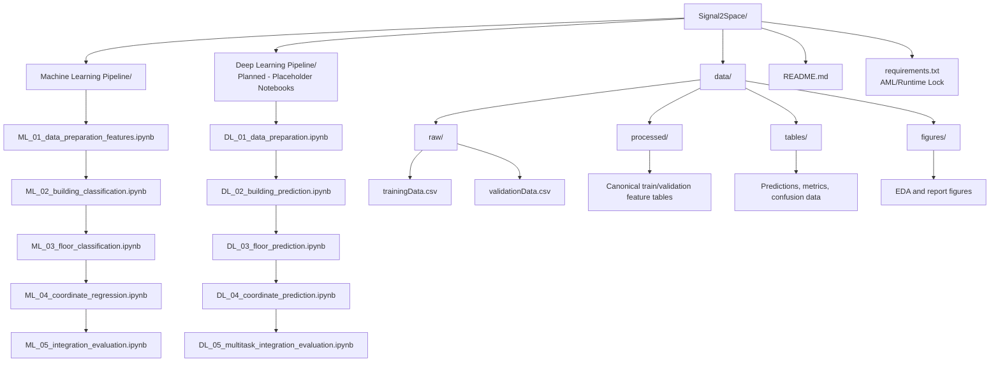
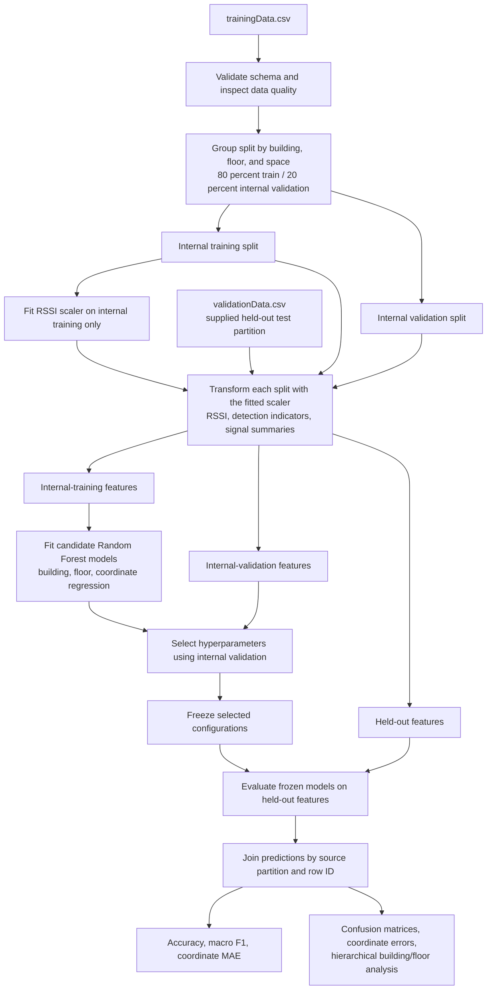
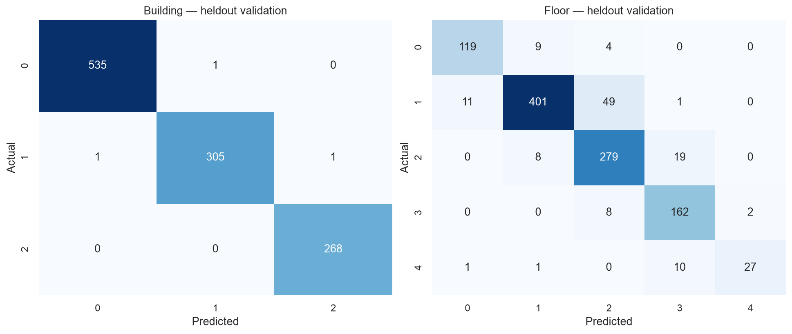
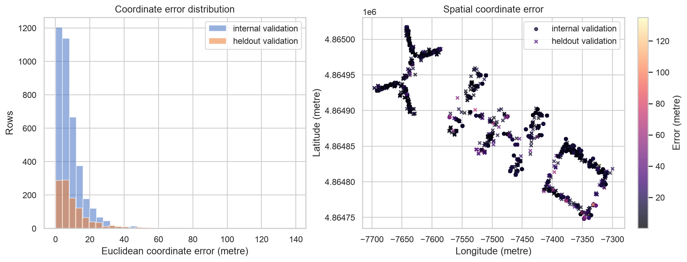
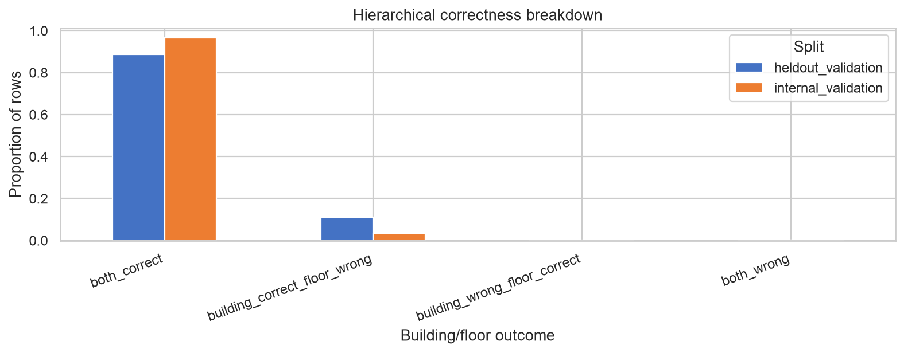

# Signal2Space

## Indoor positioning with Wi-Fi signals

Signal2Space predicts a device's building, floor, and two-dimensional position from Wi-Fi access point signal strength. The active implementation is the Phase 1 AML pipeline using shared feature preparation, Random Forest classification, coordinate regression, and integrated evaluation. Phase 2 deep learning is planned; its notebooks are placeholders and have not been implemented.

## Current status

- **Machine Learning:** Implemented and rerun end to end. Processed datasets, model result tables, and figures are kept separately under `data/processed/`, `data/tables/`, and `data/figures/`.
- **Current held-out results:** Building accuracy 99.73%; floor accuracy 88.93%; coordinate MAE 8.10 longitude-axis units and 6.81 latitude-axis units; mean Euclidean error 11.58 coordinate units. The coordinate notebook labels these units as EPSG:3857 metres, but the repository does not include authoritative CRS metadata; confirm the coordinate reference before treating that label as formally established.
- **Interpretation:** Results use the supplied UJIIndoorLoc train/validation partition and an internal group split. Fingerprint overlap and repeated coordinate values may occur across partitions, so these scores do not establish performance on unseen fingerprints or unseen positions.
- **Deep learning:** Planned.

The dataset contains 19,937 training/reference records and 1,111 validation/test records. It has 520 WAP signal fields; `100` means the access point was not detected. [UCI UJIIndoorLoc dataset documentation](https://archive.ics.uci.edu/dataset/310/ujiindoorloc)

## Project Structure



## Machine Learning Flow

This diagram shows the data and model flow, not the notebook sequence.



## ML notebook walkthrough

The notebooks run in numeric order. ML_01 creates the shared, leakage-aware data preparation used by the three task notebooks. ML_02 through ML_04 tune and evaluate separate models for the three targets. ML_05 checks and combines their predictions. The supplied `validationData.csv` remains held out until each model configuration is selected using the internal validation split.

### ML_01 — Prepare data and engineer features

`ML_01_data_preparation_features.ipynb` loads the supplied training and validation CSVs, checks their schema and data quality, and explores the signal and target fields. It treats RSSI value `100` as an undetected access point. The training partition is divided into internal training and validation groups using building, floor, and space, so records for a group stay together. The supplied validation partition is preserved for final evaluation.

The notebook fits RSSI scaling values on internal training data only, then applies that fitted transformation to all splits. It creates 520 scaled RSSI features, 520 signal-presence indicators, and six signal-summary features: number detected, strongest, mean and standard deviation of observed RSSI, number above the strong-signal threshold, and strongest access-point index. Target and identifying metadata are retained for evaluation but excluded from model predictors. The notebook writes the internal-training, internal-validation, and held-out feature tables to `data/processed/` and saves EDA plots to `data/figures/`.

### ML_02 — Classify the building

`ML_02_building_classification.ipynb` reads the three shared feature tables and trains a Random Forest building classifier. It selects its configuration using the internal validation split, then evaluates the selected configuration once on the supplied held-out partition. It excludes target and metadata columns from predictors. Predictions, metrics, tuning results, and confusion-matrix data are saved under `data/tables/`; the held-out confusion-matrix figure is saved under `data/figures/`.

### ML_03 — Classify the floor

`ML_03_floor_classification.ipynb` uses the same prepared features and partitions to train a Random Forest floor classifier. Floor classes are encoded from the internal-training labels and that mapping is used consistently for validation and held-out predictions. Hyperparameter selection uses internal validation; final scores and the floor confusion matrix use the held-out partition. Prediction and evaluation tables are saved under `data/tables/`, and the confusion-matrix figure under `data/figures/`.

### ML_04 — Regress the coordinates

`ML_04_coordinate_regression.ipynb` trains a multi-output Random Forest regressor for longitude and latitude using the shared features. Its predictor allowlist excludes the coordinate targets and identifying metadata. Candidate settings are compared on internal validation using Euclidean coordinate error, and the selected configuration is evaluated on the held-out partition. The notebook records per-axis MAE and Euclidean error, writes predictions and tuning/evaluation tables to `data/tables/`, and saves actual-versus-predicted, displacement, and error visualizations to `data/figures/`. The notebook describes coordinate errors in metres based on an EPSG:3857 assumption; the repository does not provide authoritative CRS metadata to independently confirm that unit interpretation.

### ML_05 — Integrate and evaluate the tasks

`ML_05_integration_evaluation.ipynb` reads the task predictions and source feature tables, aligns rows using source partition and row ID, checks target alignment, and recomputes the task metrics. It then reports the combined building-and-floor correctness and breaks coordinate error down by hierarchical classification outcome. Integrated predictions, summaries, confusion data, and hierarchy tables are written to `data/tables/`; combined confusion matrices, metric comparisons, coordinate errors, and hierarchical analysis figures are saved to `data/figures/`.

The held-out rows may share Wi-Fi fingerprints or repeated two-dimensional coordinates with other partitions. The results therefore describe performance under the supplied partition; evaluating unseen fingerprints or unseen positions would require a split designed specifically for that research question.

## Selected results

| Task | Held-out result |
|---|---:|
| Building classification | Accuracy **99.73%**; macro F1 **99.71%** |
| Floor classification | Accuracy **88.93%**; macro F1 **87.27%** |
| Coordinate regression | Longitude-axis MAE **8.10**; latitude-axis MAE **6.81**; mean Euclidean error **11.58** (notebook reports metres) |
| Joint building and floor correctness | **986 / 1,111** held-out rows (**88.75%**) |

These scores are specific to the supplied split. The dataset partition does not guarantee that fingerprints or two-dimensional coordinates are unique across train and evaluation data.

## Report figures

### Held-out building and floor confusion matrices



### Coordinate error distribution and spatial error



### Hierarchical building/floor correctness



## Data files

Place the supplied `trainingData.csv` and `validationData.csv` files in `data/raw/`.

- `data/processed/`: the three canonical feature tables written by ML_01.
- `data/tables/`: task predictions, tuning results, metrics, confusion-matrix data, and integrated evaluation outputs written by ML_02 through ML_05.
- `data/figures/`: selected EDA, classification, coordinate, and integrated evaluation figures.

Run the AML notebooks in numeric order from `Machine Learning Pipeline/`. ML_01 prepares the shared splits and features; ML_02, ML_03, and ML_04 produce task-specific predictions; ML_05 integrates and checks those outputs.

## Environment

The lock targets the verified Python 3.14.2 environment. Create and activate a virtual environment, then install the pinned dependencies:

```bash
python3.14 -m venv .venv
source .venv/bin/activate
python -m pip install -r requirements.txt
jupyter notebook
```

The lock includes packages required by the active AML notebooks and Jupyter execution. XGBoost and PyTorch are not included because the current AML implementation does not use them. Add Phase 2 dependencies when the DL pipeline is implemented.
