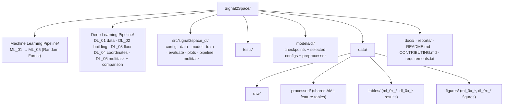
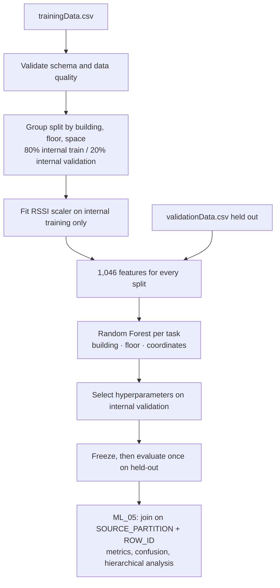
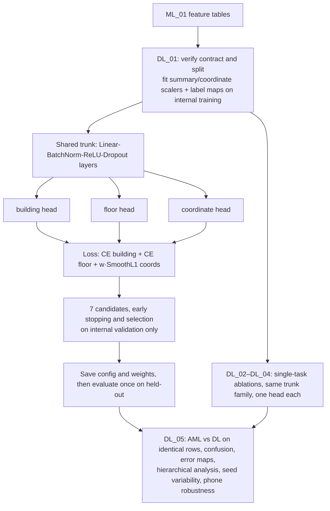
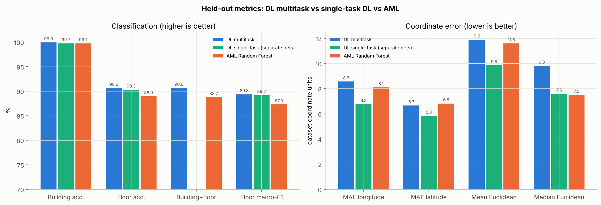
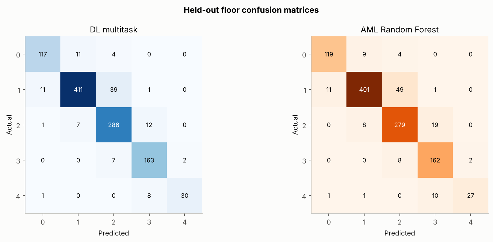
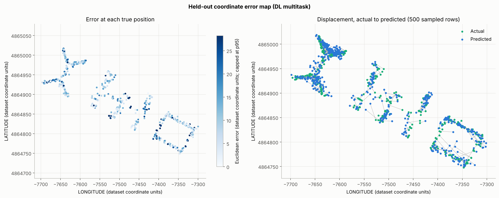
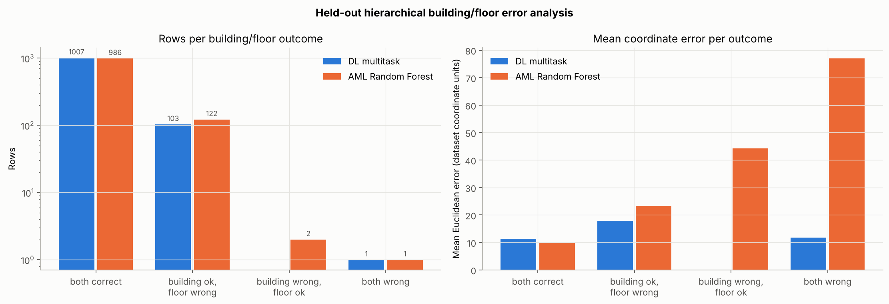
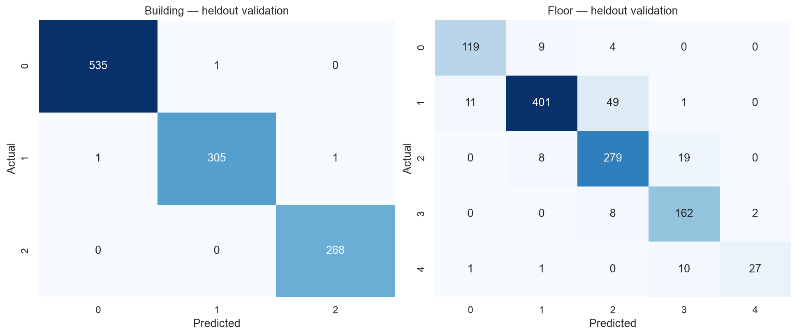
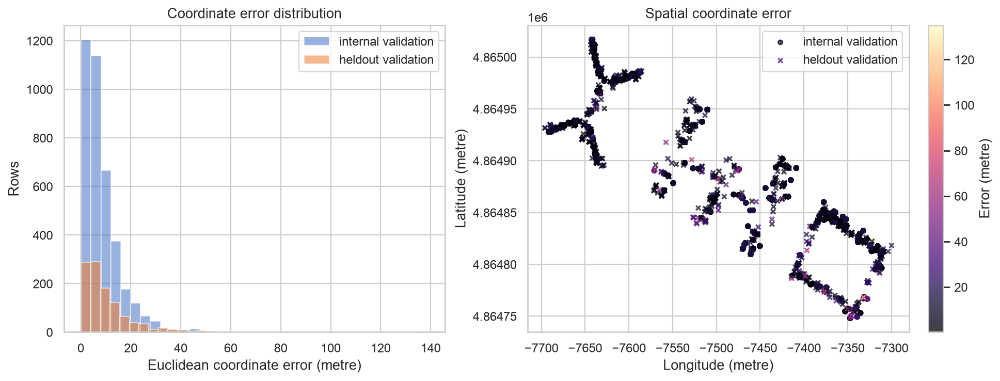

# Signal2Space

## Indoor positioning with Wi-Fi signals

Signal2Space predicts a device's **building**, **floor** and **two-dimensional position** from the signal strengths of the Wi-Fi access points it can hear (its *Wi-Fi fingerprint*). It has two phases on the same data, split and features:

1. **AML:** Random Forest models for building, floor and coordinates.
2. **DL:** a shared-trunk multitask neural network with building, floor and coordinate heads, plus single-task neural ablations, compared row-for-row with AML.

## Current status

- **Machine learning (Phase 1):** implemented and rerun end to end (`Machine Learning Pipeline/ML_01`–`ML_05`).
- **Deep learning (Phase 2):** implemented, executed and evaluated (`src/signal2space_dl/`, `Deep Learning Pipeline/DL_01`–`DL_05`, `tests/`).
- **Held-out headline:**
  - The DL multitask model reaches 90.64% floor accuracy vs 88.93% for AML (paired McNemar p = 0.014), with building accuracy 99.91% vs 99.73%.
  - Its mean coordinate error (11.88) is statistically indistinguishable from AML (11.58).
  - The single-task DL coordinate network has the lowest coordinate error (9.84).
- **Units:** coordinate errors are in **dataset coordinate units**. ML_04 labels them EPSG:3857 metres, but the repository has no authoritative CRS metadata, so they are not verified ground metres.
- **Scope:** scores describe the supplied UJIIndoorLoc partition. The held-out file was collected about three months after training, mostly with unseen phones, in the same three buildings.

Detailed documentation:
- [`docs/PROJECT_OVERVIEW.md`](docs/PROJECT_OVERVIEW.md): data, features, AML pipeline, verified AML results, limitations.
- [`docs/DL_PIPELINE.md`](docs/DL_PIPELINE.md): DL architecture, training, selection, results, comparison.
- [`CONTRIBUTING.md`](CONTRIBUTING.md): team workflow (PR-only `main`).

## Data

UJIIndoorLoc ([UCI dataset documentation](https://archive.ics.uci.edu/dataset/310/ujiindoorloc)):
- `data/raw/trainingData.csv`: 19,937 rows.
- `data/raw/validationData.csv`: 1,111 rows, used as the held-out test partition.

Each row has 520 WAP columns holding RSSI values in dBm (−104 to 0); the value **`100` means "not detected"**. The targets are `BUILDINGID` (0–2), `FLOOR` (0–4) and `LONGITUDE`/`LATITUDE` (projected values). The metadata columns (`SPACEID`, `RELATIVEPOSITION`, `USERID`, `PHONEID`, `TIMESTAMP`) are never model inputs.

| Partition | Rows | Role |
|---|---:|---|
| internal training | 16,085 | fit scalers and models |
| internal validation | 3,852 | choose hyperparameters / early stopping (grouped by building, floor, space) |
| held-out (`validationData.csv`) | 1,111 | evaluated once, after the configuration is frozen |

**Shared features (ML_01, used by both phases):** 1,046 predictors in total.
- 520 per-WAP RSSI values standardised on internal training (undetected values imputed from train-only statistics).
- 520 detected/not-detected indicators.
- 6 signal summaries: number heard, strongest, mean and standard deviation of RSSI, number of strong signals, strongest-AP index.

## Project structure



## Machine learning flow (Phase 1)



| Notebook | What it does |
|---|---|
| ML_01 | schema/quality checks, EDA, grouped split, train-only scaling, 1,046 features → `data/processed/` |
| ML_02 | building Random Forest (selected by internal-validation accuracy) |
| ML_03 | floor Random Forest, class-balanced (selected by internal-validation accuracy) |
| ML_04 | multi-output coordinate Random Forest (selected by internal-validation mean Euclidean error) |
| ML_05 | integrates the three tasks, recomputes metrics, hierarchical building/floor analysis |

## Deep learning flow (Phase 2)



The selected multitask model has a 512→256 trunk with dropout 0.3, 128-unit heads and loss weights building 1, floor 1, coordinates 2 (Smooth-L1, β = 0.1). It was trained with AdamW and early stopping at epoch 25, and has 768,906 parameters. Details are in [`docs/DL_PIPELINE.md`](docs/DL_PIPELINE.md).

## Results (held-out, 1,111 identical rows for every model)

| Metric | AML Random Forest | DL multitask | DL single-task (3 separate nets) |
|---|---:|---:|---:|
| Building accuracy / macro-F1 | 99.73% / 99.71% | **99.91% / 99.88%** | 99.73% / 99.68% |
| Floor accuracy / macro-F1 | 88.93% / 87.27% | **90.64% / 89.35%** | 90.28% / 89.17% |
| Joint building + floor correct | 88.75% (986) | **90.64% (1,007)** | — |
| Coordinate MAE, longitude / latitude axis | 8.10 / 6.81 | 8.55 / 6.65 | **6.76 / 5.83** |
| Mean / median Euclidean error | 11.58 / **7.49** | 11.88 / 9.80 | **9.84** / 7.59 |

Coordinate values are in dataset coordinate units. Sources: `data/tables/ml_05_aml_summary_metrics.csv` and `data/tables/dl_05_multitask_aml_vs_dl_comparison.csv`. On paired rows:
- the DL floor improvement is significant (37 vs 18 discordant rows, p = 0.014);
- the coordinate mean difference is not (DL − AML = +0.30, 95% CI −0.42 to +1.02).

Across three training seeds of the frozen multitask configuration, floor accuracy is 90.13% ± 0.50 pp and mean Euclidean error is 12.07 ± 0.28.

**Reading the comparison:**
- Building prediction is at ceiling for every model.
- The shared trunk gives the best floor classifier and the best joint building/floor accuracy. Its coordinate error also degrades less when the floor is wrong (17.9 vs 23.3 for AML).
- Sharing the trunk costs coordinate precision: a dedicated coordinate network is best for position.

## Figures

### Held-out metrics: AML vs DL



### Held-out floor confusion matrices (DL multitask vs AML)



### Coordinate error map (DL multitask, held-out)



### Hierarchical building/floor error analysis



### AML baseline figures





## How to run

The dependency lock was captured for the AML notebooks on Python 3.14.2 (macOS). The DL pipeline was verified on Python 3.13 with torch 2.15.0 (CPU) and the same major library versions. Create an environment and install the pinned dependencies (PyTorch's CPU build is enough):

```bash
python3 -m venv .venv
source .venv/bin/activate
python -m pip install -r requirements.txt
```

1. **AML:** run `Machine Learning Pipeline/ML_01` … `ML_05` in order in Jupyter (`jupyter notebook`). ML_01 must run before anything else, because DL reuses its feature tables.
2. **DL:** run `Deep Learning Pipeline/DL_01` … `DL_05` in order, or run everything from the command line (about 18 minutes on a 4-core CPU):

   ```bash
   PYTHONPATH=src python -m signal2space_dl.pipeline --stage all
   ```

3. **Tests:**

   ```bash
   PYTHONPATH=src python -m pytest -q tests
   ```

A quick smoke run (`--quick`) writes only to the git-ignored `outputs_smoke/` folder. Its numbers are not results.

## Limitations

- The coordinate CRS is unverified, so errors are given in dataset units, not metres.
- Results describe the supplied partition only. The held-out file shares no identical fingerprints with training and only 29 exact positions, but it covers the same buildings.
- Internal validation shares users, phones, time period, 156 identical fingerprints and many exact positions with internal training, so internal scores are optimistic.
- Held-out `USERID` is a placeholder, and 9 of 11 held-out phones never appear in training. Phone-level robustness numbers are descriptive only.
- The DL selection grids are deliberately small so that they run on a CPU.
