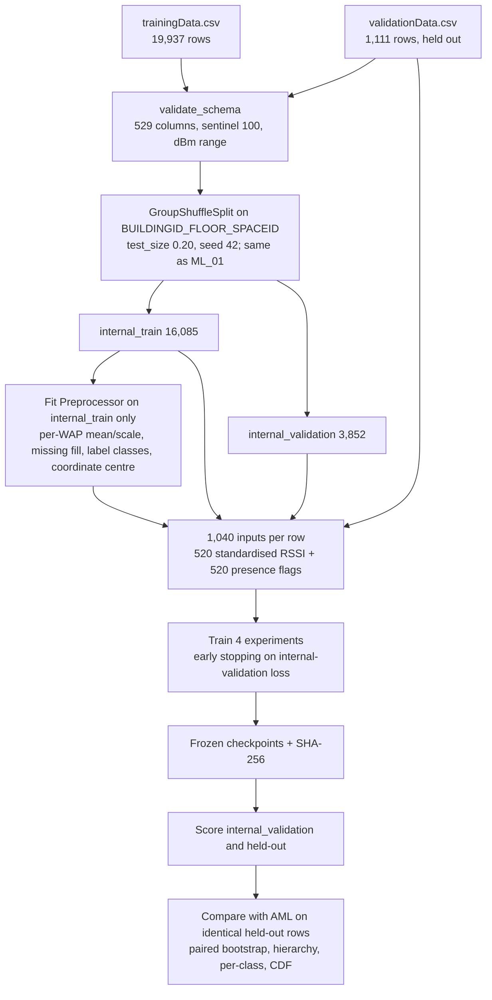

# Signal2Space deep-learning pipeline: technical reference

This document describes the Phase 2 deep-learning (DL) implementation: what it does, how to run it, what it writes, and how to read the results. The reusable code is in `src/signal2space_dl/`. The five notebooks in `Deep Learning Pipeline/` call that code and display its outputs.

## 1. Status

| Item | State |
|---|---|
| DL package `src/signal2space_dl/` | Implemented: data, model, train, evaluate, plots, CLI |
| Notebooks DL_01–DL_05 | Implemented and executed with outputs saved. They reuse the committed checkpoints. |
| Full end-to-end run | Completed with seed 42 on CPU: four models trained, all scored on internal validation and held-out |
| Unit tests `tests/` | 12 tests, all passing |
| AML pipeline and `requirements.txt` | Unchanged |

## 2. Data flow



## 3. Preprocessing and missing signals

- **Sentinel.** The value `100` means the access point was not detected. About 96.5% of training WAP entries are `100`.
- **Detected readings.** Standardised per WAP, using the mean and standard deviation of that WAP's *detected* internal-train readings.
- **Undetected readings.** Filled with that WAP's minimum training z-score minus 1, meaning "weaker than anything observed". This is the same rule as ML_01.
- **Presence flags.** Each WAP also gets a 0/1 presence indicator, so the network can tell "absent" from "weak".
- **Never-detected WAPs.** 55 WAPs never appear in internal training data. They fall back to global train statistics and carry no learned signal.
- **Input dropout.** Dropout of 0.2 on the input randomly hides inputs during training, which simulates access points that a phone fails to detect.
- **Labels.** Building classes `[0, 1, 2]` and floor classes `[0, 1, 2, 3, 4]` are encoded from internal-train labels. Any label not seen in training raises an error.
- **Coordinates.** Centred on the internal-train mean and divided by a fixed scale of 10 dataset units. Both axes share the same scale, so the loss is isotropic.

## 4. Architecture and loss

```
x (1,040) → Dropout 0.2
  → Linear 1040→512 → BatchNorm → ReLU → Dropout 0.3
  → Linear 512→256  → BatchNorm → ReLU → Dropout 0.3        (shared trunk)
  ├─ building head: Linear 256→128 → ReLU → Linear 128→3    (logits)
  ├─ floor head:    Linear 256→128 → ReLU → Linear 128→5    (logits)
  └─ coord head:    Linear 256→128 → ReLU → Linear 128→2    (scaled lon, lat)
```

**Multitask loss:** `L = 1·CE(building) + 1·CE(floor) + 1·Huber_δ=1((xy − μ_train)/10)`.

- **Why Huber on coordinates / 10:** if coordinates were z-scored over the whole campus range, a 10-unit error would contribute about 0.005 to the loss, so the coordinate head would barely train. Dividing by 10 puts a 10-unit error at roughly the size of a cross-entropy term. The Huber delta of 1 means errors beyond 10 units are penalised linearly, which bounds gradients from early large errors and from outliers.
- **Why fixed weights:** they are transparent and reproducible. Learned uncertainty weighting is a possible extension (see §9).
- **Floor head design:** one global 5-class floor head is used rather than a head per building. Hierarchical consistency is measured afterwards, in `dl_05_hierarchical_breakdown.csv`.
- **Ablations:** the single-task models use the same network with only one head enabled. They isolate the effect of sharing the trunk.

## 5. Training and model selection

| Setting | Value |
|---|---|
| Optimiser | AdamW, learning rate 1e-3, weight decay 1e-4, batch size 256 |
| Learning-rate schedule | ReduceLROnPlateau (factor 0.5, patience 5) |
| Early stopping | Patience 15 on internal-validation weighted loss; the best epoch's weights are restored |
| Maximum epochs | 150 |
| Seeding | Python, NumPy and torch seeded to 42; `torch.use_deterministic_algorithms(True, warn_only=True)`; seeded DataLoader generator |
| Device | `--device auto` picks CUDA, then MPS, then CPU |

Hyperparameters were fixed before training (`TrainConfig` in `config.py`) and were **not** tuned. Internal validation is used only for early stopping and the learning-rate schedule.

**Held-out discipline.** `train_experiment` receives only internal-train and internal-validation arrays. `evaluate_experiment` reloads the checkpoint from disk and refuses to score held-out data if its SHA-256 differs from the hash recorded at training time.

## 6. Running it

From a clean clone, at the repository root:

```bash
python3 -m venv .venv
```

```bash
source .venv/bin/activate
```

```bash
python -m pip install -r requirements-dl.txt
```

```bash
python -m pytest -q tests
```

```bash
python scripts/run_dl_pipeline.py all
```

Commands:

| Command | What it does |
|---|---|
| `python scripts/run_dl_pipeline.py prepare` | Writes the DL_01 outputs only |
| `python scripts/run_dl_pipeline.py train --experiments multitask` | Retrains one experiment and overwrites its checkpoint |
| `python scripts/run_dl_pipeline.py evaluate` | Scores the committed frozen checkpoints without training |
| `python scripts/run_dl_pipeline.py all --max-epochs 2` | Smoke test only; **not** a full run. Do not commit its outputs. |

**Notebooks.** Run DL_01 through DL_05 in order, in Jupyter. Each has `RETRAIN = False`, so it reuses the committed checkpoint. Set it to `True` to retrain that model.

**Runtime.** About 4 minutes for all four models on a 4-core CPU.

**Dependencies.** `requirements-dl.txt` contains `-r requirements.txt` plus `torch==2.15.0` and `pytest==9.2.0`, so the AML lock is not modified. On Linux, the default PyPI torch wheel pulls in about 3 GB of CUDA libraries. To avoid that, install the CPU wheel first:

```bash
python -m pip install torch==2.15.0 --index-url https://download.pytorch.org/whl/cpu
```

### Verified environment

The full run was performed on Python 3.13 (Linux, CPU, 4 cores) with torch 2.15.0, NumPy 2.5.4, pandas 3.0.6, scikit-learn 1.9.1 and matplotlib 3.11.2. The AML lock was captured on Python 3.14.2 (macOS) and has **not** been re-verified with torch on 3.14. Issue DL-0 asks the integration owner to do that on macOS.

Floating-point kernels differ across CPU, MPS and CUDA, so a rerun on another machine can differ slightly in the last digits and in the selected epoch.

## 7. Outputs

| Path | Content |
|---|---|
| `data/processed/dl_01_split_manifest.csv` | `SOURCE_PARTITION, ROW_ID, DL_SPLIT` for all 21,048 rows |
| `data/processed/dl_01_preprocessor.json` | Train-fitted preprocessing parameters |
| `data/tables/dl_01_*` | Data quality, split summary, AML split-parity check |
| `models/dl_0N_<exp>_model.pt` | Frozen checkpoint (about 3 MB): weights, config, embedded preprocessor |
| `models/dl_0N_<exp>_model.json` | Selected epoch, SHA-256, parameter count, runtime, environment |
| `data/tables/dl_0N_<exp>_training_history.csv` | Per-epoch losses, internal-validation metrics, learning rate, selected epoch |
| `data/tables/dl_0N_<exp>_{internal,heldout}_predictions.csv` | Row-level predictions, class probabilities, coordinate errors |
| `data/tables/dl_0N_<exp>_metrics.csv` | Metrics for internal validation and held-out |
| `data/tables/dl_05_model_comparison.csv` | All DL models and AML, both splits, same metric functions |
| `data/tables/dl_05_vs_aml_paired_bootstrap.csv` | DL minus AML, 95% CI over the identical held-out rows (2,000 resamples) |
| `data/tables/dl_05_hierarchical_breakdown.csv` | Building/floor outcome classes with coordinate error |
| `data/figures/dl_*.png` | Input representation, training curves, confusion matrices, error maps, CDF, comparison |

## 8. Results

All results are from the full run with seed 42. The held-out partition is `validationData.csv` (1,111 rows), the same partition and metric definitions as AML. The AML numbers below were recomputed from ML_05's row-level predictions and match the README.

| Held-out | AML Random Forest | DL single-task | DL multitask |
|---|---:|---:|---:|
| Building accuracy / macro F1 | 99.73% / 99.71% | 99.82% / 99.83% | **99.91%** / 99.88% |
| Floor accuracy / macro F1 | 88.93% / 87.27% | **89.92%** / 88.43% | 89.56% / 88.15% |
| Coordinate MAE, longitude / latitude | 8.10 / 6.81 | **7.24 / 6.11** | 8.62 / 6.72 |
| Mean / median Euclidean error | 11.58 / **7.49** | **10.51** / 8.13 | 12.00 / 9.53 |
| p90 Euclidean error / RMSE | 24.39 / 17.67 | **21.35 / 13.46** | 23.71 / 15.02 |
| Joint building + floor correct | 986 / 1,111 | — | **995** / 1,111 |

**Paired bootstrap, DL minus AML, 95% CI:**

| Model | Metric | Difference | 95% CI |
|---|---|---:|---|
| building_only | Building accuracy | +0.09 pp | [−0.18, +0.36] |
| floor_only | Floor accuracy | +0.99 pp | [−0.36, +2.43] |
| coordinate_only | Mean error | −1.08 | [−1.78, −0.37] |
| multitask | Building accuracy | +0.18 pp | [−0.18, +0.54] |
| multitask | Floor accuracy | +0.63 pp | [−0.72, +1.89] |
| multitask | Mean error | +0.42 | [−0.33, +1.16] |

**How to read these results:**

- The **coordinate-only** DL model is the only one whose difference from AML is resolved on this split. It has a lower mean error, p90 error and RMSE, but a higher median error. It reduces large errors, while the Random Forest is more precise on typical rows.
- Building and floor differences are within sampling noise.
- **Sharing the trunk cost coordinate accuracy.** The multitask mean error is 12.00, compared with 10.51 for coordinate-only.
- The per-task winners were identified on held-out data *after* every model was frozen. Choosing a per-task combination now would be a post-hoc choice. Any change to the loss weights must be made on internal validation and then re-scored once.

## 9. Limitations and caveats

- **Coordinate units and CRS.** The values look like Web-Mercator metres, and ML_04 labels them EPSG:3857, but the repository holds no authoritative CRS metadata. All errors are in *dataset units*. Web-Mercator distances exceed ground distance by about 1/cos(latitude). This check is assigned in issue DL-4.
- **Supplied split.** `validationData.csv` was recorded later, by other users and devices. That is a realistic shift, but it does not establish performance at unseen positions, in unseen buildings, or on arbitrary new devices. Internal-validation floor accuracy is about 97%; held-out is about 90%.
- **Class imbalance.** Floor 4 exists only in building 2 and has 39 held-out rows, with recall of 72–74%. Inverse-frequency class weighting is implemented (`TrainConfig.class_weighting`) but was off for the reported run. It is assigned for evaluation on internal validation in issue DL-3.
- **No hyperparameter search, single seed.** Seed variance has not been measured. A multi-seed run is a recommended follow-up.
- **Not done here:** learned uncertainty loss weighting, building-conditioned floor heads, and data augmentation beyond input dropout.
