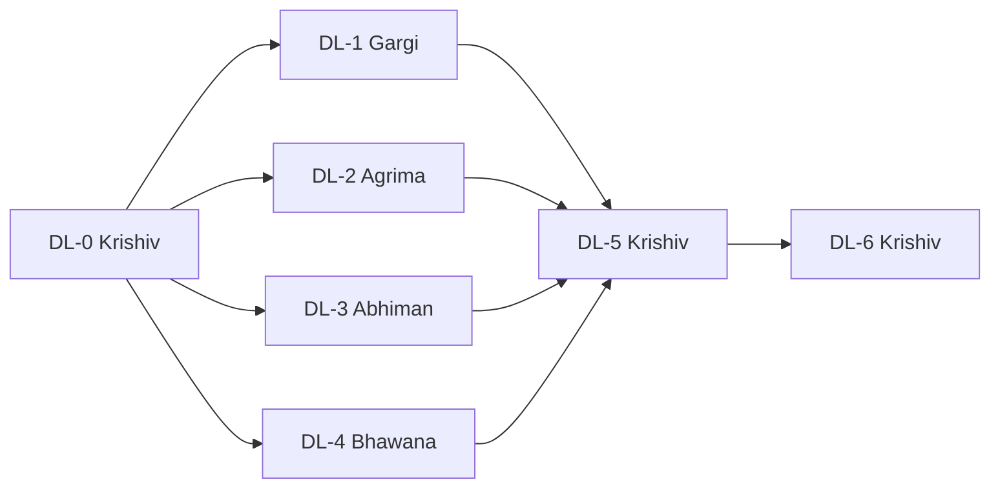

# Signal2Space DL phase: team plan, branches and handoff

- **Planner (Notion):** https://app.notion.com/p/415e7fb36c6881d9b60effca159d11d5
- **Repository:** https://github.com/krishiv274/Signal2Space
- **Integration branch:** `claude/peaceful-shannon-o1t6j8`
- **Integration PR:** [#7](https://github.com/krishiv274/Signal2Space/pull/7) · **Tracker issue:** [#6](https://github.com/krishiv274/Signal2Space/issues/6)
- **Issue bodies (record):** `docs/github_plan/`

## Who does what

| # | Member | GitHub | Role | Issues | Handoff ZIP |
|---|---|---|---|---|---|

| 1 | Krishiv | `krishiv274` | Integration owner | DL-0 [#8](https://github.com/krishiv274/Signal2Space/issues/8), DL-5 [#13](https://github.com/krishiv274/Signal2Space/issues/13), DL-6 [#14](https://github.com/krishiv274/Signal2Space/issues/14) | [`Signal2Space_DL_handoff_1_Krishiv_krishiv274.zip`](https://github.com/krishiv274/Signal2Space/blob/claude/peaceful-shannon-o1t6j8/handoff/Signal2Space_DL_handoff_1_Krishiv_krishiv274.zip) |
| 2 | Gargi | `gigabyte2024` | Data & leakage audit (DL_01) | DL-1 [#12](https://github.com/krishiv274/Signal2Space/issues/12) | [`Signal2Space_DL_handoff_2_Gargi_gigabyte2024.zip`](https://github.com/krishiv274/Signal2Space/blob/claude/peaceful-shannon-o1t6j8/handoff/Signal2Space_DL_handoff_2_Gargi_gigabyte2024.zip) |
| 3 | Agrima | `slayplayagrima` | Building head & robustness (DL_02) | DL-2 [#9](https://github.com/krishiv274/Signal2Space/issues/9) | [`Signal2Space_DL_handoff_3_Agrima_slayplayagrima.zip`](https://github.com/krishiv274/Signal2Space/blob/claude/peaceful-shannon-o1t6j8/handoff/Signal2Space_DL_handoff_3_Agrima_slayplayagrima.zip) |
| 4 | Abhiman | `Koray-afk` | Floor head & class imbalance (DL_03) | DL-3 [#10](https://github.com/krishiv274/Signal2Space/issues/10) | [`Signal2Space_DL_handoff_4_Abhiman_Koray-afk.zip`](https://github.com/krishiv274/Signal2Space/blob/claude/peaceful-shannon-o1t6j8/handoff/Signal2Space_DL_handoff_4_Abhiman_Koray-afk.zip) |
| 5 | Bhawana | `bhawanaydv` | Coordinate head & CRS/units (DL_04) | DL-4 [#11](https://github.com/krishiv274/Signal2Space/issues/11) | [`Signal2Space_DL_handoff_5_Bhawana_bhawanaydv.zip`](https://github.com/krishiv274/Signal2Space/blob/claude/peaceful-shannon-o1t6j8/handoff/Signal2Space_DL_handoff_5_Bhawana_bhawanaydv.zip) |

DL-6 (viva) involves all five members; Krishiv coordinates it.

## Sequence and dependencies

| Step | ID | Issue | Owner | Work | Start when | Branch | Effort (estimate) |
|---|---|---|---|---|---|---|---|
| 1 | DL-0 | [#8](https://github.com/krishiv274/Signal2Space/issues/8) | Krishiv | Review, verify on macOS and merge the DL integration PR | Start now | `claude/peaceful-shannon-o1t6j8` | about 2–3 hours |
| 2 | DL-1 | [#12](https://github.com/krishiv274/Signal2Space/issues/12) | Gargi | Data & leakage audit: real-data tests for DL_01 split and preprocessing | Start now on your pre-created branch; open the PR into main after DL-0 merges; merges first in step 2 | `dl/01-data-audit-gigabyte2024` | about 4–6 hours |
| 2 | DL-2 | [#9](https://github.com/krishiv274/Signal2Space/issues/9) | Agrima | Building head: error review and missing-AP robustness (DL_02) | Start now on your pre-created branch, in parallel with DL-1, DL-3 and DL-4; open the PR after DL-0 merges; merge after DL-1 | `dl/02-building-robustness-slayplayagrima` | about 4–6 hours |
| 2 | DL-3 | [#10](https://github.com/krishiv274/Signal2Space/issues/10) | Abhiman | Floor head: per-building errors and class-weighting ablation (DL_03) | Start now on your pre-created branch, in parallel with DL-1, DL-2 and DL-4; open the PR after DL-0 merges; merge after DL-1 | `dl/03-floor-imbalance-Koray-afk` | about 5–7 hours |
| 2 | DL-4 | [#11](https://github.com/krishiv274/Signal2Space/issues/11) | Bhawana | Coordinate head: error analysis and CRS/unit verification (DL_04) | Start now on your pre-created branch, in parallel with DL-1, DL-2 and DL-3; open the PR after DL-0 merges; merge after DL-1 | `dl/04-coordinate-crs-bhawanaydv` | about 4–6 hours |
| 3 | DL-5 | [#13](https://github.com/krishiv274/Signal2Space/issues/13) | Krishiv | Final integration: re-run, reconcile results, update report/PPT, tag release | Start after DL-1 to DL-4 are merged | `dl/05-integration-krishiv274` | about 4–6 hours |
| 4 | DL-6 | [#14](https://github.com/krishiv274/Signal2Space/issues/14) | All five (Krishiv coordinates) | Viva recordings (≤5 min each) for all five members | Rehearse any time; record after DL-5 so the numbers are final | `(no branch; links are posted as issue comments)` | about 1–2 hours per member |

**What can start now**
- **Everyone.** Krishiv starts DL-0: verify and merge PR #7. Gargi, Agrima, Abhiman and Bhawana start DL-1 to DL-4 on their branches, which were created from the integration branch and already contain all the DL code.
- **Only opening and merging member PRs waits for DL-0.**

**Merge order** (open member PRs as drafts until #7 merges)
1. DL-0: PR #7, merged with a merge commit, not squash.
2. DL-1, so that the data guarantees are tested before anything builds on them.
3. DL-2, DL-3 and DL-4 in any order, each rebased on the latest `main`.
4. DL-5.
5. DL-6 after DL-5.

**Avoiding conflicts.** In step 2, each member owns different files: DL-1 owns `tests/test_dl_data_real.py` and DL_01; DL-2 owns DL_02 and adds a function to `evaluate.py`; DL-3 owns DL_03 and edits `config.py`/`cli.py`; DL-4 owns DL_04. Shared files (`docs/DL_PIPELINE.md`, `evaluate.py`) get small additive edits in separate sections. Rebase onto `main` before you open your PR.

## Branch and PR conventions

| Item | Convention |
|---|---|
| Branch name | `dl/<step-no>-<topic>-<github-id>`. The DL-1 to DL-4 branches already exist and were created from the integration branch; DL-5 is created from `main` later. |
| Commit message | `DL-<n>: <imperative summary> (refs #<issue>)` |
| PR title | `[DL-<n>] <issue title>` |
| PR body | Must contain `Closes #<issue>`, the acceptance checklist, and the output of `pytest` and `evaluate` |
| Reviewer | `krishiv274`; DL-0 and DL-5 are reviewed by all four members |
| Merge | Krishiv merges after review and green local checks. PR #7 must use a merge commit; member PRs may be squash-merged. |
| Never | Force-push to `main`, commit raw data or large files, retrain committed checkpoints in place, or change models based on held-out results |

## Current results (from the committed full run)

See `docs/DL_PIPELINE.md` §8. The held-out multitask results are building 99.91%, floor 89.56% and mean coordinate error 12.00. The coordinate-only model's mean error is 10.51, against 11.58 for AML.
