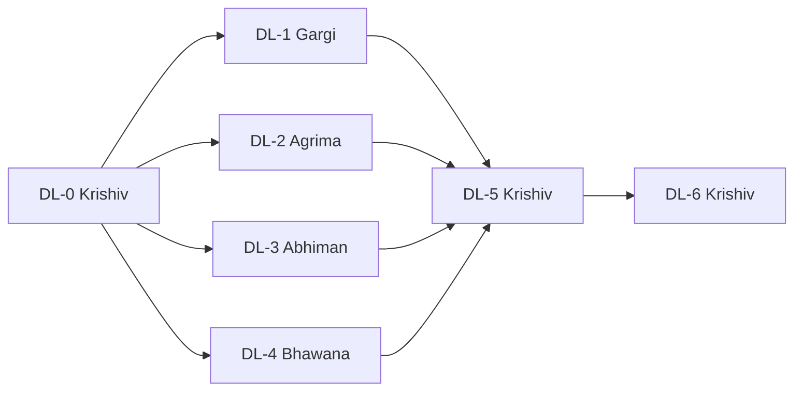

# Signal2Space DL phase: team plan, branches and handoff

- **Planner (Notion):** https://app.notion.com/p/415e7fb36c6881d9b60effca159d11d5
- **Repository:** https://github.com/krishiv274/Signal2Space
- **Integration branch:** `claude/peaceful-shannon-o1t6j8`
- **Issue bodies and creation script:** `docs/github_plan/`, `scripts/create_github_plan.sh`

> **Status of GitHub actions.** The issues, member branches and integration PR below are **planned and not yet created**. GitHub refused writes from the setup session with HTTP 403 (`Resource not accessible by integration`). Krishiv creates them in DL-0 with the script. Until then, issues are referred to by the stable IDs DL-0 to DL-6.

## Who does what

| # | Member | GitHub | Role | Issues | Handoff ZIP |
|---|---|---|---|---|---|

| 1 | Krishiv | `krishiv274` | Integration owner | DL-0, DL-5, DL-6 | [`Signal2Space_DL_handoff_1_Krishiv_krishiv274.zip`](https://github.com/krishiv274/Signal2Space/blob/claude/peaceful-shannon-o1t6j8/handoff/Signal2Space_DL_handoff_1_Krishiv_krishiv274.zip) |
| 2 | Gargi | `gigabyte2024` | Data & leakage audit (DL_01) | DL-1 | [`Signal2Space_DL_handoff_2_Gargi_gigabyte2024.zip`](https://github.com/krishiv274/Signal2Space/blob/claude/peaceful-shannon-o1t6j8/handoff/Signal2Space_DL_handoff_2_Gargi_gigabyte2024.zip) |
| 3 | Agrima | `slayplayagrima` | Building head & robustness (DL_02) | DL-2 | [`Signal2Space_DL_handoff_3_Agrima_slayplayagrima.zip`](https://github.com/krishiv274/Signal2Space/blob/claude/peaceful-shannon-o1t6j8/handoff/Signal2Space_DL_handoff_3_Agrima_slayplayagrima.zip) |
| 4 | Abhiman | `Koray-afk` | Floor head & class imbalance (DL_03) | DL-3 | [`Signal2Space_DL_handoff_4_Abhiman_Koray-afk.zip`](https://github.com/krishiv274/Signal2Space/blob/claude/peaceful-shannon-o1t6j8/handoff/Signal2Space_DL_handoff_4_Abhiman_Koray-afk.zip) |
| 5 | Bhawana | `bhawanaydv` | Coordinate head & CRS/units (DL_04) | DL-4 | [`Signal2Space_DL_handoff_5_Bhawana_bhawanaydv.zip`](https://github.com/krishiv274/Signal2Space/blob/claude/peaceful-shannon-o1t6j8/handoff/Signal2Space_DL_handoff_5_Bhawana_bhawanaydv.zip) |

DL-6 (viva) involves all five members; Krishiv coordinates it.

## Sequence and dependencies

| Step | ID | Owner | Work | Start when | Branch | Effort (estimate) |
|---|---|---|---|---|---|---|
| 1 | DL-0 | Krishiv | Review, verify on macOS and merge the DL integration PR | Start now | `claude/peaceful-shannon-o1t6j8` | about 2–3 hours |
| 2 | DL-1 | Gargi | Data & leakage audit: real-data tests for DL_01 split and preprocessing | Start after DL-0 is merged; merge first in step 2 | `dl/01-data-audit-gigabyte2024` | about 4–6 hours |
| 2 | DL-2 | Agrima | Building head: error review and missing-AP robustness (DL_02) | Start after DL-0 is merged; parallel with DL-1, DL-3 and DL-4; merge after DL-1 | `dl/02-building-robustness-slayplayagrima` | about 4–6 hours |
| 2 | DL-3 | Abhiman | Floor head: per-building errors and class-weighting ablation (DL_03) | Start after DL-0 is merged; parallel with DL-1, DL-2 and DL-4; merge after DL-1 | `dl/03-floor-imbalance-Koray-afk` | about 5–7 hours |
| 2 | DL-4 | Bhawana | Coordinate head: error analysis and CRS/unit verification (DL_04) | Start after DL-0 is merged; parallel with DL-1, DL-2 and DL-3; merge after DL-1 | `dl/04-coordinate-crs-bhawanaydv` | about 4–6 hours |
| 3 | DL-5 | Krishiv | Final integration: re-run, reconcile results, update report/PPT, tag release | Start after DL-1 to DL-4 are merged | `dl/05-integration-krishiv274` | about 4–6 hours |
| 4 | DL-6 | All five (Krishiv coordinates) | Viva recordings (≤5 min each) for all five members | Rehearse any time; record after DL-5 so the numbers are final | `(no branch; links are posted as issue comments)` | about 1–2 hours per member |

**What can start now**
- **Krishiv:** DL-0.
- **Everyone else:** set up the environment, read `docs/DL_PIPELINE.md` and your handoff README, run `evaluate`, and rehearse your viva outline.

**Merge order**
1. DL-0.
2. DL-1, so that the data guarantees are tested before anything builds on them.
3. DL-2, DL-3 and DL-4 in any order, each rebased on the latest `main`.
4. DL-5.
5. DL-6 after DL-5.

**Avoiding conflicts.** In step 2, each member owns different files: DL-1 owns `tests/test_dl_data_real.py` and DL_01; DL-2 owns DL_02 and adds a function to `evaluate.py`; DL-3 owns DL_03 and edits `config.py`/`cli.py`; DL-4 owns DL_04. Shared files (`docs/DL_PIPELINE.md`, `evaluate.py`) get small additive edits in separate sections. Rebase onto `main` before you open your PR.

## Branch and PR conventions

| Item | Convention |
|---|---|
| Branch name | `dl/<step-no>-<topic>-<github-id>`, created from `main` after DL-0 merges |
| Commit message | `DL-<n>: <imperative summary> (refs #<issue>)` |
| PR title | `[DL-<n>] <issue title>` |
| PR body | Must contain `Closes #<issue>`, the acceptance checklist, and the output of `pytest` and `evaluate` |
| Reviewer | `krishiv274`; DL-0 and DL-5 are reviewed by all four members |
| Merge | Squash-merge by Krishiv after review and green local checks |
| Never | Force-push to `main`, commit raw data or large files, retrain committed checkpoints in place, or change models based on held-out results |

## Current results (from the committed full run)

See `docs/DL_PIPELINE.md` §8. The held-out multitask results are building 99.91%, floor 89.56% and mean coordinate error 12.00. The coordinate-only model's mean error is 10.51, against 11.58 for AML.
